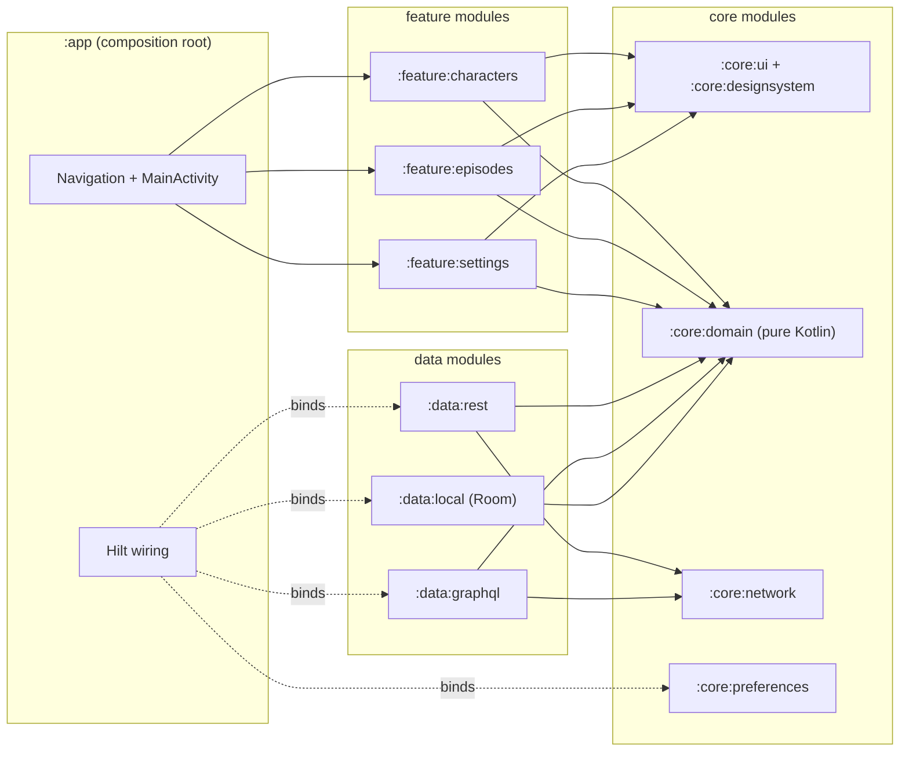

# RickVerse-Android

 

A Jetpack Compose app that talks to **one backend through two APIs**: **REST** (Retrofit + OkHttp +
kotlinx.serialization) and **GraphQL** (Apollo Kotlin). Both sit behind a single Domain interface and the app switches
between them at runtime, so the two can be compared fairly (request counts, cache behaviour, error handling).

## What this project demonstrates
1. **Clean Architecture, multi-module, enforced by machines**: pure-Kotlin Domain, convention plugins, Konsist + a grep script.
2. **REST vs GraphQL on the same screen**: the N+1 problem measured 52 -> 2 -> 1 -> 0 requests ([benchmark](docs/benchmark.md)).
3. **Resilient networking**: retry with jittered backoff and `Retry-After`, idempotency rules, a token `Authenticator`, a shared network log.
4. **Coroutines done carefully**: debounced search with `flatMapLatest`, no stale results, cancellation never swallowed, injected dispatchers.
5. **Offline-first cache** (Room, with a real migration) plus Apollo's normalized cache and four cache policies.
6. **Quality pipeline and AI guardrails**: tiered CI, nightly contract and schema-drift checks, SHA-pinned actions, `CLAUDE.md`, a no-merge AI reviewer.

## Architecture

Arrows point inward. `:core:domain` has no Android dependency (prove it: `./gradlew :core:domain:dependencies --configuration runtimeClasspath`).
`:data:local` decorates whichever backend is active, so features never know about caching.

| Module | Role |
|---|---|
| `:app` | `@HiltAndroidApp`, navigation, DI modules choosing implementations (`@Rest`, `@GraphQl`, `@Remote`) |
| `:core:domain` | Entities, `DomainResult`/`DomainError`, repository interfaces, use cases (pure Kotlin) |
| `:core:common`, `:core:network` | Dispatchers; OkHttp factory, interceptors, `NetworkLog`, `Authenticator` |
| `:core:preferences` | DataStore settings (data source, cache policy) |
| `:core:ui`, `:core:designsystem` | Shared Compose pieces (error state, pagination footer, banner), theme |
| `:data:rest` / `:data:graphql` / `:data:local` | Retrofit; Apollo (types `internal`); Room offline cache |
| `:feature:*` | Characters, Episodes, Settings (MVVM, `StateFlow`, sealed UI state) |
| `:architecture-tests`, `:contract-tests`, `:benchmark` | Konsist rules; live-API contract/benchmark (gated); Macrobenchmark + baseline profile |

## REST vs GraphQL
Loading a character with 51 episodes: **52** requests (naive REST), **2** (REST batch endpoint), **1** (GraphQL), **0**
(GraphQL `CacheFirst` hit). Request counts are asserted by tests; device timings are a TODO and not invented.
Details and caveats: [`docs/benchmark.md`](docs/benchmark.md).

## Key decisions ([`docs/adr`](docs/adr))
[0001 multi-module](docs/adr/0001-multi-module-clean-architecture.md) ·
[0002 DomainResult](docs/adr/0002-domain-result-instead-of-exceptions.md) ·
[0003 ViewModels without Compose](docs/adr/0003-viewmodels-free-of-compose.md) ·
[0004 one interface, two backends](docs/adr/0004-one-repository-interface-two-backends.md) ·
[0005 Apollo types internal](docs/adr/0005-apollo-types-internal.md) ·
[0006 partial GraphQL data](docs/adr/0006-graphql-partial-data-policy.md) ·
[0007 Retrofit/OkHttp, not Ktor](docs/adr/0007-retrofit-okhttp-not-ktor.md) ·
[0008 Hilt, not Koin](docs/adr/0008-hilt-not-koin.md) ·
[0009 reset on source switch](docs/adr/0009-reset-ui-on-data-source-switch.md) ·
[0010 offline-first / pagination](docs/adr/0010-offline-first-and-pagination.md) ·
[0011 AI guardrails](docs/adr/0011-ai-in-the-workflow.md).
Interview prep: [`docs/interview-answers.md`](docs/interview-answers.md), per-phase [`docs/notes.md`](docs/notes.md).

## Run it
Open in Android Studio (its bundled JDK is used for Gradle; JDK 21+ required, bytecode targets 17), then:

| Command | Does |
|---|---|
| `./gradlew :app:installDebug` | Install on a device/emulator |
| `./gradlew test` | All JVM unit tests (Robolectric Compose UI tests included) |
| `./gradlew spotlessApply assembleDebug test detekt spotlessCheck lint koverVerify --continue` | The full local gate (what CI runs) |
| `./gradlew :data:graphql:generateApolloSources` | Apollo codegen |
| `./gradlew :contract-tests:contractTest` | Live API checks (network, never in PRs) |
| `./gradlew :app:connectedDebugAndroidTest` | Hilt + Compose e2e on an emulator |
| `./gradlew :app:generateBaselineProfile` | Baseline profile (device needed) |
| `./gradlew dokkaGeneratePublicationHtml` | API docs into `build/dokka/html` |
| `scripts/check-architecture.sh` | Layer rules with CI annotations |

Compose compiler reports: `-Prickverse.composeMetrics=true`. Release signing only activates with `KEYSTORE_PATH` etc. (CI).

## Known limitations and what I would do next
* The API is read-only: no mutations or subscriptions, so optimistic updates and subscriptions are discussed, not built.
* Offline lists are network-first with a Room fallback, not a strict database-as-source-of-truth; episodes are not cached
  offline; the cache has no expiry ([ADR 0010](docs/adr/0010-offline-first-and-pagination.md)).
* No tablet list-detail layout, no Paging 3 variant, no in-product AI feature (needs a backend proxy to keep keys off the device).
* Next: run everything on a device, record real benchmark numbers, a crash reporter (decode failures in production are
  currently invisible), and per-module CODEOWNERS.

## How I use AI in this repo
Rules live in [`CLAUDE.md`](CLAUDE.md); narrow read-only subagents and slash commands in [`.claude/`](.claude); a hook
blocks edits to generated files; [`ai-review.yml`](.github/workflows/ai-review.yml) reviews PRs without merge rights and
treats PR text as untrusted. Linters and tests stay the authority. Policy and trade-offs: [ADR 0011](docs/adr/0011-ai-in-the-workflow.md).
