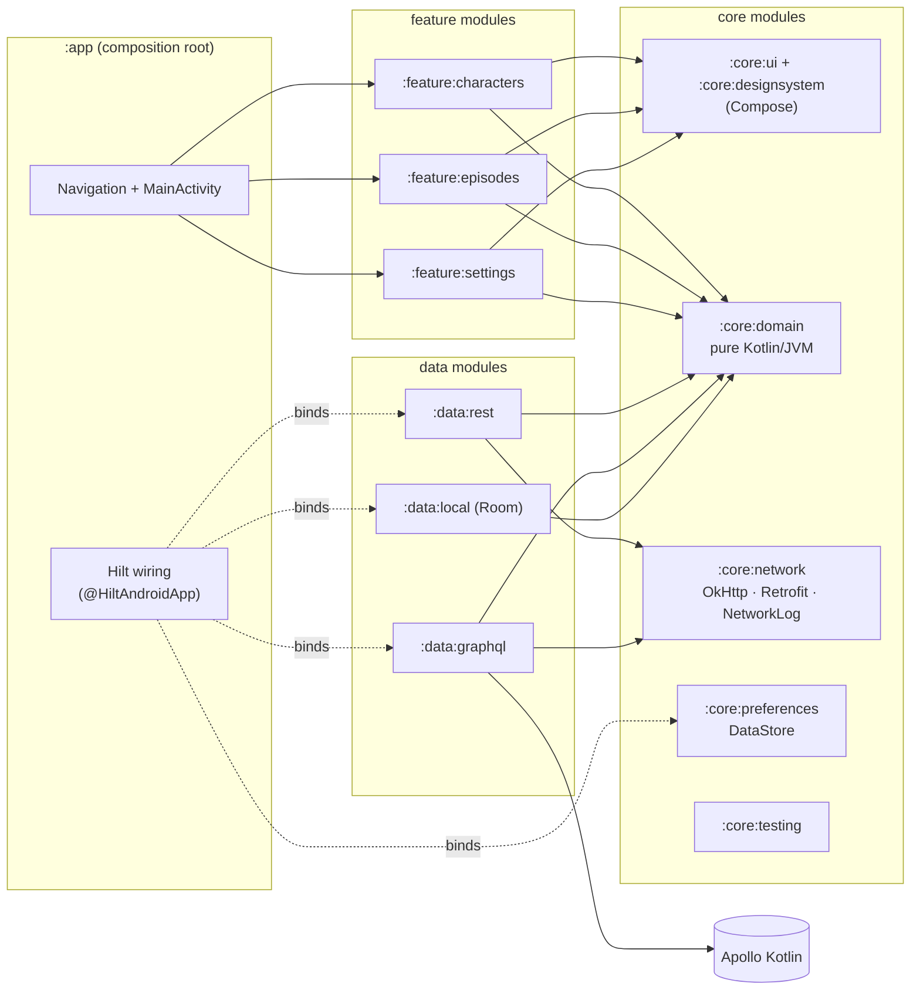

# RickVerse Android — Build Guide

> A Jetpack Compose Android app that talks to the **same backend through two different APIs**: **REST** (Retrofit + OkHttp + kotlinx.serialization) and **GraphQL** (Apollo Kotlin). Both sit behind one Domain interface, so the app can switch between them at runtime.
>
> **Goal:** become an expert in calling backend services with REST and GraphQL on Android, using Clean Architecture + MVVM, a multi-module Gradle build and Hilt, and have a portfolio project you can defend line by line with a senior Android interviewer. This is the Kotlin twin of `RickVerse-Guide.md` (the Swift guide). It uses the same phases, the same backend and the same interview story.

**How to use this guide**

- Work through the phases in order. Each phase has **Theory → Build → Done when → Commit**.
- This guide contains **no app code**. The few snippets are configuration or shape references to unblock non-obvious parts. Type every file yourself, because typing it is how you learn it.
- Every phase ends with a commit (or a PR into `main`). A clean history is part of what interviewers look at.
- Write the "Interview angle" notes from each phase into `docs/notes.md` in your own words.
- **Versions:** this guide names libraries, not version numbers. Take the latest stable of each when you start, put it in `gradle/libs.versions.toml`, and let Dependabot/Renovate keep it fresh. Where an API has changed between major versions, the guide says "check the docs for your version" instead of guessing.

**Decisions already made** (so you can defend them): Hilt for DI · Retrofit + OkHttp + kotlinx.serialization for REST · Apollo Kotlin for GraphQL · layer modules + feature modules + convention plugins · full parity with the iOS app plus Android extras (Room, Paging 3, baseline profiles).

**Assumed defaults** (change them if you like): package `com.<yourname>.rickverse`, `minSdk 26`, `targetSdk`/`compileSdk` = latest stable, Kotlin 2.x (K2 compiler), Java 17 toolchain, Gradle Kotlin DSL, JUnit 4 for Android modules.

---

## Table of contents

0. [The finished project](#0-the-finished-project)
1. [Swift → Kotlin cheat sheet](#swift--kotlin-cheat-sheet)
2. [Phase 0 — Repo, Gradle skeleton, version catalog, convention plugins](#phase-0--repo-gradle-skeleton-version-catalog-convention-plugins)
3. [Phase 1 — Domain module](#phase-1--domain-module)
4. [Phase 2 — REST theory + `:core:network`](#phase-2--rest-theory--corenetwork)
5. [Phase 3 — `:data:rest`: DTOs, mapping, repositories](#phase-3--datarest-dtos-mapping-repositories)
6. [Phase 4 — Hilt composition + Characters list (ViewModel + Compose)](#phase-4--hilt-composition--characters-list-viewmodel--compose)
7. [Phase 5 — Detail + Episodes: the N+1 problem in REST](#phase-5--detail--episodes-the-n1-problem-in-rest)
8. [Phase 6 — GraphQL theory + Apollo Kotlin setup + codegen](#phase-6--graphql-theory--apollo-kotlin-setup--codegen)
9. [Phase 7 — `:data:graphql` repositories + runtime switch](#phase-7--datagraphql-repositories--runtime-switch)
10. [Phase 8 — Apollo advanced: cache, policies, interceptors, network log](#phase-8--apollo-advanced-cache-policies-interceptors-network-log)
11. [Phase 9 — Testing strategy](#phase-9--testing-strategy)
12. [Phase 10 — Android extras: offline, Paging 3, performance, accessibility](#phase-10--android-extras-offline-paging-3-performance-accessibility)
13. [Phase 11 — GitHub Actions: the CI/CD pipeline](#phase-11--github-actions-the-cicd-pipeline)
14. [Phase 12 — How AI improves this project](#phase-12--how-ai-improves-this-project)
15. [Phase 13 — Polish for interviewers](#phase-13--polish-for-interviewers)
16. [Screens & interactions spec](#screens--interactions-spec)
17. [Interview question bank](#interview-question-bank)

---

## 0. The finished project

### What the app does

| Tab | Screens | What it demonstrates |
|---|---|---|
| **Characters** | Searchable, filterable, infinitely scrolling list → Character detail with episodes | Pagination, debounced search, coroutine cancellation, the N+1 problem |
| **Episodes** | List grouped by season → Episode detail with a grid of characters | Batching in REST vs a nested query in GraphQL |
| **Settings** | Data source switch (REST / GraphQL), cache policy, network log, clear cache | Runtime swapping of the Data layer, observability |

### The backend

The **Rick and Morty API**, which is free, needs no API key, and exposes both styles:

- REST: `https://rickandmortyapi.com/api`
- GraphQL: `https://rickandmortyapi.com/graphql`

Same data, two APIs. That makes it a fair comparison. All the real-world quirks listed in the Swift guide still apply (404 on an empty search, a single-id batch returning an object instead of an array, `next` as a URL string in REST but an `Int` in GraphQL, nullable GraphQL fields). Read Phase 3 and Phase 7 of the Swift guide for the details. This guide adds only what is Android-specific.

### Architecture



**The dependency rule:** arrows point inward, toward `:core:domain`. Domain is a **pure Kotlin/JVM module**, so it can't even import `android.*`. Features see Domain, never DTOs, Retrofit or Apollo. Only `:app` knows every module, because Hilt needs it to assemble the graph.

### Module table

| Module | Type | Depends on | Contains |
|---|---|---|---|
| `:app` | Android application | everything | `@HiltAndroidApp`, `MainActivity`, navigation graph, DI modules that choose implementations |
| `:core:domain` | **Kotlin JVM** | nothing | Entities, `DomainError`, `DomainResult`, repository interfaces, use cases |
| `:core:common` | Kotlin JVM | nothing | `DispatcherProvider`, small utilities |
| `:core:network` | Kotlin JVM | `:core:common` | OkHttp client factory, interceptors (headers, logging, retry, metrics), `NetworkLog`, `NetworkError` |
| `:core:preferences` | Android library | `:core:domain` | DataStore implementation of `SettingsRepository` |
| `:data:rest` | Kotlin JVM (or Android lib) | `:core:domain`, `:core:network` | Retrofit services, DTOs, mappers, REST repositories |
| `:data:graphql` | Android lib | `:core:domain`, `:core:network` | `.graphql` files, Apollo codegen output (internal), mappers, GraphQL repositories |
| `:data:local` | Android library | `:core:domain` | Room database, DAOs, offline-cache decorators (Phase 10) |
| `:core:designsystem` | Android library | none of the above | Theme, `AvatarImage`, `StatusBadge`, shimmer |
| `:core:ui` | Android library | `:core:domain`, `:core:designsystem` | `DomainError` → user message, shared states (`ErrorState`, `PaginationFooter`) |
| `:feature:characters` | Android library | `:core:domain`, `:core:ui` | ViewModels + Compose screens for the list and the detail |
| `:feature:episodes` | Android library | same | Episodes list and detail |
| `:feature:settings` | Android library | same | Settings + network log |
| `:core:testing` | Android/JVM library | `:core:domain` | Fakes, `MainDispatcherRule`, fixture loader, MockWebServer helpers |
| `:benchmark` | com.android.test | `:app` | Macrobenchmark + baseline profile generator (Phase 10) |
| `build-logic/convention` | included build | — | Convention plugins (Phase 0) |

### Final folder structure

```
RickVerse/
├── README.md  .gitignore  .editorconfig
├── CLAUDE.md                       ← AI/agent rules for this repo (Phase 12)
├── settings.gradle.kts  build.gradle.kts  gradle.properties
├── gradle/libs.versions.toml       ← the single version catalog
├── gradle/wrapper/                 ← committed
├── build-logic/convention/         ← convention plugins
├── config/detekt/detekt.yml
├── scripts/                        ← check-architecture.sh, create-labels.sh
├── .github/
│   ├── actions/setup-android/action.yml
│   ├── workflows/                  ← ci, lint, pr-hygiene, graphql, contract, codeql, docs, release, benchmark, ai-review, publish
│   ├── dependabot.yml  labeler.yml  release.yml  CODEOWNERS  pull_request_template.md
├── .claude/                        ← project subagents/commands (Phase 12)
├── docs/  GUIDE.md  notes.md  benchmark.md  adr/  screenshots/
├── app/
├── core/{domain,common,network,preferences,designsystem,ui,testing}/
├── data/{rest,graphql,local}/
├── feature/{characters,episodes,settings}/
└── benchmark/
```

Inside each feature module, keep two packages with a hard rule between them:

```
feature/characters/src/main/kotlin/.../characters/
├── presentation/   CastListViewModel, CastListUiState, CastListIntent   ← NO androidx.compose imports
└── ui/             CastListScreen, CastRow, StatusFilterBar              ← Compose lives here
```

### Why ViewModels and Composables share a module here (and how you still protect the boundary)

| Decision | Reason you give in an interview |
|---|---|
| ViewModels import only `androidx.lifecycle`, coroutines and Domain, never `androidx.compose.*` | They stay JVM-testable with plain unit tests (no Robolectric), and a UI toolkit swap wouldn't touch them. An architecture test (Konsist, Phase 9) fails the build if a `..presentation..` file imports Compose. |
| Compose UI is stateless below the screen composable: `Screen(state, onIntent)` | Previews, screenshot tests and UI tests need no ViewModel or Hilt. |
| Domain is a pure JVM module | The compiler enforces "Domain imports nothing". It's the strongest form of the dependency rule you can get on Android. |
| `:app` is the only module that binds interfaces to implementations | Switching REST ↔ GraphQL is one Hilt binding, and no feature knows the difference. |
| Apollo-generated types are `internal` to `:data:graphql` | The rule is enforced by Kotlin visibility, not by discipline. |

---

## Swift → Kotlin cheat sheet

Keep this open. It's also the fastest way to explain the project to an interviewer who has seen the iOS version.

| Swift guide | Android guide |
|---|---|
| Local Swift package, 5 targets | Gradle multi-module build, ~15 modules, convention plugins |
| `Domain` imports nothing | `:core:domain` is `kotlin("jvm")`. No Android on the classpath. |
| `throws(DomainError)` typed throws | `DomainResult<T>` sealed type (`Success` / `Failure(DomainError)`). Kotlin has no typed throws. **Never swallow `CancellationException`.** |
| `async/await`, `TaskGroup`, `Task` | `suspend`, `coroutineScope { async {} }`, `Job` / `viewModelScope` |
| `AsyncStream` | `Flow` / `StateFlow` / `SharedFlow` |
| `@Observable @MainActor` ViewModel | `@HiltViewModel` + `StateFlow<UiState>`, collected with `collectAsStateWithLifecycle()` |
| `.task {}` / `.refreshable` | `LaunchedEffect` / `PullToRefreshBox` |
| `URLSession` + middleware chain | OkHttp + `Interceptor` chain (+ Retrofit) |
| `URLProtocolStub` | `MockWebServer` (queue responses, assert recorded requests) |
| `Codable` + `CodingKeys` | `@Serializable` + `@SerialName` (kotlinx.serialization) |
| `OneOrMany<T>` custom decoder | A `JsonTransformingSerializer` |
| Apollo iOS codegen CLI | Apollo Kotlin Gradle plugin (codegen runs inside `./gradlew generateApolloSources`) |
| `ApolloStore` + `InMemoryNormalizedCache` / SQLite | `normalizedCache(MemoryCacheFactory…)` chained with `SqlNormalizedCacheFactory` |
| Apollo interceptors | `ApolloInterceptor` **and** the shared `OkHttp` interceptors (one network log for both APIs) |
| `AppContainer` + `ViewModelFactory` | **Hilt** modules in `:app` (`@Binds`, `@Provides`, qualifiers) |
| `@AppStorage` | Preferences **DataStore** exposed as a `Flow` |
| `.id(dataSource)` resets the tree | `key(dataSource)` + resetting the back stack (see Phase 7) |
| `NavigationStack(path:)`, `Route: Hashable` | Navigation 3 back stack of `@Serializable` `NavKey` routes (or Navigation Compose with typed routes) |
| Swift Testing, `@Test(arguments:)` | JUnit 4 + parameterized tests, `kotlinx-coroutines-test`, Turbine, MockK |
| SwiftLint + swift-format | detekt + ktlint (via Spotless) + Android Lint |
| `check-architecture.sh` (grep) | The same script **plus** Konsist tests plus Gradle's own module graph |
| `macos-26` runners (expensive) | `ubuntu-latest` runners for almost everything (cheap), KVM-accelerated emulator |
| DocC → GitHub Pages | Dokka → GitHub Pages |
| TestFlight upload | Google Play internal testing track (signed AAB) |

---

## Phase 0 — Repo, Gradle skeleton, version catalog, convention plugins

### Theory

- **Why multi-module?** Enforced boundaries, parallel and incremental builds, and ownership. The cost is configuration. **Convention plugins** remove that cost: the module's `build.gradle.kts` becomes five lines.
- **Version catalog** (`libs.versions.toml`): one place for every version and library alias, and type-safe accessors (`libs.hilt.android`).
- **`api` vs `implementation`:** default to `implementation` so transitive types don't leak. A module should expose another module's types in its public API only on purpose.
- **Build performance basics:** configuration cache, build cache, parallel execution, KSP instead of kapt.

### Build

1. Create the GitHub repo `RickVerse-Android` (public, MIT, Android/Kotlin `.gitignore`).
2. Create the project in Android Studio (**Empty Activity / Compose**), package `com.<you>.rickverse`, `minSdk 26`. Keep only `:app`.
3. **Version catalog.** Create `gradle/libs.versions.toml` with sections `[versions]`, `[libraries]`, `[plugins]`, and group libraries with **bundles** where it helps. Libraries you'll need over the project: Compose BOM + Material 3 + adaptive, Activity-Compose, Navigation 3 (or Navigation Compose), Lifecycle (`runtime-compose`, `viewmodel-compose`), Hilt (+ `hilt-navigation-compose`), Retrofit + OkHttp (+ `logging-interceptor` for debug only) + kotlinx.serialization + the Retrofit serialization converter, Coil 3, Apollo Kotlin (+ normalized cache + SQLite cache), Room, DataStore, Paging, Coroutines, and test libraries (MockK, Turbine, MockWebServer, Robolectric only if needed, Compose UI test, Hilt testing, Roborazzi or Paparazzi, Konsist).
4. **Convention plugins** in `build-logic/convention` (an *included build* declared in `settings.gradle.kts` via `pluginManagement { includeBuild("build-logic") }`):

   | Plugin id | Applies |
   |---|---|
   | `rickverse.android.application` | AGP application, Kotlin Android, SDK levels, Java 17, R8 config for release, `buildFeatures` |
   | `rickverse.android.library` | AGP library, Kotlin, Java 17, `explicitApi()` for library modules |
   | `rickverse.kotlin.library` | Pure JVM module (used by `:core:domain`, `:core:common`, `:core:network`) |
   | `rickverse.android.compose` | Compose compiler plugin + BOM + tooling |
   | `rickverse.android.feature` | Library + Compose + Hilt + lifecycle + Domain/UI dependencies + test deps |
   | `rickverse.hilt` | Hilt plugin + KSP |
   | `rickverse.quality` | detekt, Spotless/ktlint, Kover |

5. Create empty modules following the table above. Each has a 5-line `build.gradle.kts` that applies one convention plugin and declares its dependencies. A module with no sources is fine for now. Comment out the Apollo, Room and benchmark modules in `settings.gradle.kts` until you reach them.
6. `gradle.properties`: enable `org.gradle.parallel`, `org.gradle.caching`, `org.gradle.configuration-cache`, and a sensible `org.gradle.jvmargs`. Check the AGP release notes for your version for flags that are now defaults.
7. **Dependency direction check:** run `./gradlew :core:domain:dependencies --configuration runtimeClasspath`. It must list only Kotlin stdlib and (if you add it) coroutines. Save this command in the README. It is your first proof of the dependency rule.
8. Add `.editorconfig`, detekt and ktlint config, and the wrapper. **Commit the Gradle wrapper**, and commit `gradle/libs.versions.toml`.

### Done when
- [ ] `./gradlew assembleDebug` and `./gradlew test` pass on an empty skeleton
- [ ] Every module builds from a convention plugin, with no copy-pasted `android {}` blocks
- [ ] `:core:domain` has no Android dependency (prove it with the command above)
- [ ] `docs/GUIDE.md` (this file) is committed

### Interview angle
> *"Why convention plugins and a version catalog?"* One place to change SDK levels and Kotlin options, consistent modules, and a build that scales to a team. Mention configuration cache and what breaks it.

**Commit:** `chore: bootstrap multi-module Gradle build with convention plugins`

---

## Phase 1 — Domain module

### Theory

- **Entity vs DTO**, **repository interface** and **use case**: same as the Swift guide, Phase 1.
- **Error modelling without typed throws.** Pick one and write an ADR:
  1. `DomainResult<T>` sealed type (recommended, which is the closest to typed throws; callers must handle failure with an exhaustive `when`).
  2. `kotlin.Result<T>` (can't carry a typed error, so callers `catch` a generic `Throwable`).
  3. Throw domain exceptions (hides failure from the signature).
- **Coroutine rule:** `CancellationException` must **never** be converted into a `DomainError` and shown. Catch it and rethrow, or map it to a silent no-op at the ViewModel boundary. A `try/catch (e: Exception)` that swallows cancellation is the #1 coroutine bug.
- **Kotlin multiplatform-friendly purity:** use `kotlinx-datetime` or `java.time` (pure JVM, fine) for dates. No `android.*`.

### Build — in `:core:domain`

| Package / file | Contents |
|---|---|
| `model/CastMember` | `data class` with `id: Int`, `name`, `status: Status`, `species`, `imageUrl: String`. Nested `enum class Status { Alive, Dead, Unknown }`. Mark the class `@Immutable`-free here (see the Compose note below). |
| `model/CastMemberDetail` | `member`, `gender`, `originName`, `locationName`, `episodes: List<Episode>` |
| `model/Episode` | `id`, `name`, `code` ("S01E01"), `season`, `number`, `airDate: LocalDate?` |
| `model/EpisodeDetail` | `episode`, `cast: List<CastMember>` |
| `model/Page<T>` | `items: List<T>`, `nextPage: Int?`, computed `hasMore` |
| `model/CastFilter` | `name: String?`, `status: CastMember.Status?` |
| `error/DomainError` | `sealed interface`: `Offline`, `Timeout`, `NotFound`, `Server`, `InvalidData`, `Unknown` (no `Cancelled`, because cancellation is an exception, see above) |
| `error/DomainResult<T>` | `Success(value)` / `Failure(error)`, plus `map`, `fold`, and a `runCatchingDomain { }` helper that rethrows `CancellationException` |
| `repository/CastRepository` | `suspend fun cast(page: Int, filter: CastFilter): DomainResult<Page<CastMember>>` and `suspend fun detail(id: Int): DomainResult<CastMemberDetail>` |
| `repository/EpisodeRepository` | `episodes(page)` and `detail(id)` |
| `repository/SettingsRepository` | `val dataSource: Flow<DataSource>`, `val cachePolicy: Flow<CachePolicy>`, setters. `DataSource` and `CachePolicy` are Domain enums. |
| `usecase/*` | `SearchCastUseCase`, `GetCastMemberDetailUseCase`, `GetEpisodesUseCase`, `GetEpisodeDetailUseCase`. Each is a class with `@Inject constructor` and `operator fun invoke`. |

> The `javax.inject` annotations (`@Inject`) are a tiny pure-Java dependency (`javax.inject` or `jakarta.inject`). Accepting that is a deliberate, documented trade-off (ADR). The alternative is providing use cases from a Hilt module in `:app`. Pick one and say why.

> ⚠️ Don't name the entity `Character`. It shadows `kotlin.Char`/`java.lang.Character` confusion and reads badly. Use `CastMember`.

**Compose stability note.** Kotlin collections (`List`) are treated as unstable by the Compose compiler unless strong skipping is on, which is the default in current Kotlin/Compose. Don't pollute Domain with `@Immutable`. If you need it, map to UI models in the feature module or enable the Compose compiler's stability configuration file. Explain this in an interview.

### Tests (`:core:domain` unit tests, plain JUnit + coroutines-test)

Write a `FakeCastRepository` that **records** the arguments it receives. Prove:
- `"   "` → `filter.name == null`; `" rick "` → `"rick"`; status passes through
- a `Failure(Offline)` reaches the caller unchanged
- parameterized trimming cases (JUnit 4 `Parameterized`, or JUnit 5 `@ParameterizedTest` if you pick JUnit 5 for JVM modules)
- `runCatchingDomain` **rethrows** `CancellationException` (test this explicitly)

### Interview angle
> *"Your use case only trims a string and forwards it. Isn't that over-engineering?"* Same answer as the Swift guide: a stable seam, one obvious place for rules, testability, and honesty ("in a tiny app, ViewModels could call repositories directly. Here's how I'd decide").

**Commit:** `feat(domain): entities, repository interfaces, use cases, DomainResult`

---

## Phase 2 — REST theory + `:core:network`

### Theory you must be able to explain

The REST theory table in the Swift guide, Phase 2, applies unchanged: resources and methods, idempotency, status codes, headers, HTTP caching, pagination styles, retry with exponential backoff and jitter, cancellation, token refresh. Android-specific additions:

| Topic | Key points |
|---|---|
| **OkHttp interceptors** | *Application* interceptors (`addInterceptor`) see the logical request once. *Network* interceptors (`addNetworkInterceptor`) see each hop, including redirects and retries. Know which one your logger, retry and metrics need. |
| **Retry in OkHttp** | OkHttp already retries *connection* failures (`retryOnConnectionFailure`). Your retry interceptor is for **HTTP-level** retry (5xx/408/429) on idempotent methods. |
| **Cancellation** | Retrofit `suspend` functions cancel the underlying `Call` when the coroutine is cancelled. A cancelled request is **not** an error to show. |
| **HTTP cache** | OkHttp `Cache` honors `Cache-Control`/`ETag`. Configure a disk cache directory in `:app` and pass it in. Core modules never touch `Context`. |
| **Threading** | Retrofit `suspend` calls are main-safe. Do JSON mapping on a background dispatcher you inject. |
| **Auth refresh** | OkHttp `Authenticator` is designed for 401 → refresh → retry. Make refresh single-flight with a `Mutex` (the Android equivalent of the Swift `actor`). Exercise only: this API has no auth. |
| **Timeouts** | Connect, read, write and the whole-call timeout. Set them explicitly and justify the numbers. |
| **Serialization** | kotlinx.serialization is compile-time, reflection-free and R8-friendly. `ignoreUnknownKeys = true`, `coerceInputValues`, and explicit-null settings are decisions worth explaining. |

### Build — `:core:network` (Kotlin JVM, no `Context`)

| File | Responsibility |
|---|---|
| `NetworkError` | Transport-level sealed type: `Offline`, `Timeout`, `Http(status, body)`, `Decoding(message)`, `Transport(message)`. No Domain knowledge. |
| `NetworkErrors.kt` | **One place** that maps `Throwable` → `NetworkError`: `UnknownHostException`/`ConnectException` → `Offline`, `SocketTimeoutException` → `Timeout`, `SerializationException` → `Decoding`, `HttpException` → `Http`. `CancellationException` is rethrown, never mapped. |
| `OkHttpClientFactory` | Builds the `OkHttpClient` from injected config (cache, timeouts, interceptors). The only place that configures OkHttp. |
| `interceptor/DefaultHeadersInterceptor` | `Accept: application/json`, `User-Agent: RickVerse/1.0 (Android)` |
| `interceptor/LoggingInterceptor` | Method, URL, status, duration. Never log auth headers or bodies in release. Redact with `redactHeader`. |
| `interceptor/RetryInterceptor` | Backoff + full jitter, idempotent methods only, 5xx/408/429/timeout, honors `Retry-After`, **injected sleep function** so tests are instant, stops if the call is cancelled (`chain.call().isCanceled()`) |
| `interceptor/MetricsInterceptor` | Writes one `NetworkEvent` per call to `NetworkLog` (Phase 8). The same interceptor will also log Apollo's calls. |
| `NetworkLog` | Thread-safe event store exposing `events: Flow<List<NetworkEvent>>`. Back it with a `MutableStateFlow` and bounded size. |
| `auth/TokenStore`, `auth/TokenAuthenticator` | **Exercise only**: attach a bearer token, refresh once on 401 behind a `Mutex`, retry. Tested with fakes. |
| `Json` factory | Shared `Json { ignoreUnknownKeys = true … }`. Dates need a custom serializer because the API's `created` has fractional seconds (`2017-11-04T18:48:46.250Z`). Check how `Instant.parse` handles it vs your target type. |

`RetryInterceptor` spec (same as the Swift `RetryMiddleware`): `maxAttempts = 3`, `base = 500 ms`, delay = `random(0..base * 2^attempt)`, idempotent methods only (`GET`, `HEAD`, `PUT`, `DELETE`), retry on 408/429/5xx and timeouts, `Retry-After` wins, inject the sleeper.

> Interceptors run on OkHttp's threads and may block, because `Thread.sleep` is legal there. Say that out loud, and say why the retry delay is still injectable.

### Tests (`:core:network`, plain JVM)

Use **MockWebServer**:
- URL building: path + query, percent-encoding of `"Rick Sanchez"`
- default headers present (inspect `server.takeRequest()`)
- 200 → decoded; 404 → `Http(404)`; malformed JSON → `Decoding`
- retry: 503, 503, 200 → success after 3 requests; a 400 is **not** retried; a `POST` is **not** retried; `Retry-After: 2` is honored (assert via the injected sleeper)
- cancellation: cancel the coroutine mid-request → no retry, no error surfaced
- `NetworkErrors` mapping table, parameterized
- **Run each test with its own `MockWebServer`** (`@Before` / `@After`) so no shared state is needed. This is an easier model than the Swift `URLProtocolStub`.

**Commit:** `feat(network): OkHttp client factory, interceptor chain, retry, NetworkLog`

---

## Phase 3 — `:data:rest`: DTOs, mapping, repositories

### The REST endpoints

Same table as the Swift guide, Phase 3 (`/character`, `/character/{id}`, `/character/1,2,3`, `/episode`, `/episode/1,2,3`). Try every endpoint with `curl` first. Save real responses as fixtures under `data/rest/src/test/resources/fixtures/`:

```bash
curl -s "https://rickandmortyapi.com/api/character?page=1" > characters_page1.json
curl -s "https://rickandmortyapi.com/api/character/1"      > character_1.json
curl -s "https://rickandmortyapi.com/api/episode/1,2,3"    > episodes_1_2_3.json
```

Quirks to handle, unchanged: **(1)** a search with no matches returns `404` → map to an empty `Page`, not `NotFound`; **(2)** a single-id batch returns an **object**, not an array; **(3)** `info.next` is a URL, so extract the `page` query parameter with `HttpUrl`/`URI`; **(4)** `air_date` is `"December 2, 2013"`, so parse it with an explicit **`Locale.ENGLISH`** `DateTimeFormatter`, or it breaks on devices set to Spanish.

### Build — `:data:rest`

| Folder / file | Contents |
|---|---|
| `dto/PageDto<T>`, `InfoDto` | `@Serializable`. `info.next: String?`. |
| `dto/CharacterDto`, `EpisodeDto` | Mirror the JSON **exactly**, with `@SerialName` for snake_case (`air_date`). Keep them `internal`. |
| `dto/OneOrMany<T>` | A `JsonTransformingSerializer` that wraps a lone object in an array. |
| `api/CharacterApi`, `EpisodeApi` | Retrofit interfaces with `suspend` functions. Return DTOs, never `Response<T>` unless you need headers. Mark `internal`. |
| `mapper/CharacterMapper`, `EpisodeMapper` | DTO → Domain. An unknown status string → `Unknown`, never crash. Parse "S01E01" → season 1, number 1. |
| `mapper/NextPageParser`, `TrailingId` | `"…/episode/28"` → `28`. |
| `mapper/ErrorMapper` | `NetworkError` → `DomainError` (404 → `NotFound`, 5xx → `Server`, `Decoding` → `InvalidData`…). The *only* place where network knowledge meets Domain. |
| `repository/RestCastRepository` | Implements `CastRepository`. Uses an injected `CoroutineDispatcher`, wraps calls with `runCatchingDomain`. |
| `repository/RestEpisodeRepository` | Implements `EpisodeRepository`. |
| `di/RestModule` | Hilt module `@InstallIn(SingletonComponent::class)`: provides the `Retrofit`, the API interfaces, and `@Binds @Rest CastRepository`. Everything else in the module is `internal`. |

Implement only `cast(page, filter)` now, and have `detail` return `Failure(Unknown)` until Phase 5.

**Qualifiers:** define `@Rest` and `@GraphQl` qualifiers in `:core:domain` (or a tiny `:core:di-api`), so `:app` can ask for either implementation without knowing the concrete classes.

### Tests (`:data:rest`, JVM)

- Mapper tests against the real fixtures
- Repository test with MockWebServer returning the 404 "nothing here" body → empty `Page`
- `nextPage` extracted correctly, and `null` on the last page
- Unknown status `"Zombie"` → `Unknown`
- `OneOrMany` decodes both shapes
- Retrofit cancellation propagates (no `Failure(Unknown)` emitted when cancelled)

**Commit:** `feat(rest): DTOs, mappers and REST cast repository`

---

## Phase 4 — Hilt composition + Characters list (ViewModel + Compose)

The first time you see real data on screen.

### Theory: MVVM + UDF on Android

- **View** = a function of state: `Screen(state: UiState, onIntent: (Intent) -> Unit)`.
- **ViewModel** = holds `StateFlow<UiState>`, handles intents, survives configuration changes. Coming from BLoC: ViewModel ≈ Cubit, `UiState` ≈ state, intents ≈ events.
- **UDF (unidirectional data flow):** state flows down, events flow up. Never let the UI mutate state directly.
- **One-off events** (toasts, navigation) are modeled as **state** that the UI consumes and acknowledges, not as a `SharedFlow` that can be lost on rotation. Explain why.
- **Lifecycle-aware collection:** `collectAsStateWithLifecycle()`. Know why plain `collectAsState()` keeps collecting while the app is in the background.
- **`SavedStateHandle`** for state that must survive process death (the search query, the selected filter).
- **Hilt scopes:** `@Singleton` (app), `@ViewModelScoped`, `@HiltViewModel`. Repositories are singletons, and use cases are unscoped.

### Build — composition root (`:app`)

| File | Contents |
|---|---|
| `RickVerseApp` | `@HiltAndroidApp Application`. Configures Coil's image loader (memory + disk cache sizes). |
| `di/NetworkModule` | Provides the shared `OkHttpClient` from `OkHttpClientFactory` (cache dir from `Context`), `Json`, `NetworkLog`, and `DispatcherProvider`. |
| `di/RepositoryModule` | Binds `CastRepository` and `EpisodeRepository` to a **`SwitchingCastRepository`** that delegates to `@Rest` or `@GraphQl` based on `SettingsRepository.dataSource` (Phase 7). For now it binds REST directly. |
| `MainActivity` | `@AndroidEntryPoint`, `enableEdgeToEdge()`, sets the Compose content, observes settings for theme. |
| `navigation/Route` | `@Serializable` route types (`CastList`, `CastDetail(id)`, `EpisodeList`, `EpisodeDetail(id)`, `Settings`, `NetworkLog`). |
| `navigation/RootNavigation` | Bottom navigation with **three independent back stacks** (one per tab) so switching tabs preserves each stack. |

### Build — `:feature:characters`

`presentation/CastListViewModel`, with the same behaviors as the Swift guide, translated to coroutines:

```
UiState:   phase (Idle | Loading | Loaded | Empty | Failed(error)), items, pagination (Idle | Loading | Failed(error) | Exhausted), query, statusFilter
Intents:   QueryChanged, StatusSelected, Refresh, Retry, ItemAppeared(item), RetryNextPage
```

1. **Debounced search.** Keep a `MutableStateFlow` of the query and pipe it through `debounce(400ms)` → `distinctUntilChanged` → `flatMapLatest { load(page 1) }`. `flatMapLatest` **cancels the previous request automatically**. The status filter bypasses the debounce (use `merge` or two flows combined).
2. **Stale-response protection.** `flatMapLatest` mostly gives you this for free. Explain *why it's sufficient*, and then add a test that proves it. For the manual page-2 load, guard with a `Job` + `generation` counter.
3. **Pagination.** Trigger when the visible item is among the last 5, `pagination == Idle` and `nextPage != null`. Append, de-duplicating by `id`. A page failure sets `pagination = Failed` but **keeps the items already loaded**.
4. **Cancellation is silent.** Never convert `CancellationException` to a `Failed` state.
5. **Refresh** keeps the current items visible until page 1 arrives.
6. **State survives rotation and process death:** `query` and `statusFilter` in `SavedStateHandle`; items reload.
7. **Expose state with `stateIn(viewModelScope, SharingStarted.WhileSubscribed(5_000), initial)`.** Explain what 5 seconds buys you (config changes don't restart the upstream).
8. **No `Context`, no Compose, no Android views in the ViewModel.** Inject `SearchCastUseCase` only.

`ui/` package (Compose):

| File | Contents |
|---|---|
| `CastListRoute` | Gets the VM with `hiltViewModel()`, collects state, passes `(state, onIntent)` to the screen |
| `CastListScreen` | Stateless. `Scaffold` + search field + `StatusFilterBar` + `LazyColumn`. Uses `key = { it.id }` and `contentType`. |
| `CastRow`, `StatusFilterBar` | Row = avatar + name + `StatusBadge` + species. Chips for All/Alive/Dead/Unknown. |
| `@Preview` functions | One per state (loading, content, empty, error) with fake data. Previews are free documentation. |

Shared pieces in `:core:designsystem` and `:core:ui`: `AvatarImage` (Coil `AsyncImage` with placeholder, error, `contentDescription`), `StatusBadge` (colored dot **plus text**), `ErrorState` (icon + message + Retry), `PaginationFooter`, shimmer skeleton, and `DomainError.toMessage()` (user-facing copy lives in `:core:ui`, never in Domain or the ViewModel).

**Pagination trigger in Compose:** use `derivedStateOf` on `LazyListState` (last visible index vs item count) inside a `LaunchedEffect`/`snapshotFlow`, so it fires once per threshold crossing, not on every scroll frame. This is a classic interview topic.

### Tests

*ViewModel unit tests (JVM, no Robolectric):* `kotlinx-coroutines-test` (`runTest`, `StandardTestDispatcher`, **virtual time**, so `advanceTimeBy(400)` tests the debounce with **no real sleeping**, which is better than the Swift `debounce: .zero` trick), `MainDispatcherRule`, Turbine for `StateFlow` assertions, and a scripted `FakeCastRepository`.
- init → `Loading` → `Loaded`; empty → `Empty`; failure → `Failed(Offline)`; cancellation → no error state
- typing "r", "ri", "ric", "rick" within 400 ms triggers **exactly one** request ("rick")
- **stale response:** the fake delays "ri" longer than "rick", and final items are from "rick"
- `ItemAppeared(last)` loads page 2 once, even if sent twice; page-2 failure keeps page-1 items
- status filter reaches the repository; state restored from `SavedStateHandle`

*Compose tests (`createComposeRule`, no Hilt):* each state renders; clicking Retry emits the intent; semantics merged for accessibility.

**Commit:** `feat: characters list with search, filter, pagination (REST)`

---

## Phase 5 — Detail + Episodes: the N+1 problem in REST

### Theory

Identical to the Swift guide, Phase 5: to show a character with their episodes over REST, you need `GET /character/1` and then one request per episode. That's **52 requests** for Rick. The mitigations are, from worst to best:

1. **Naive sequential**: 52 round trips in a row.
2. **Concurrent with coroutines**: `coroutineScope { ids.map { async { … } }.awaitAll() }` is still 52 requests. Limit concurrency with a `Semaphore(6)` or `limitedParallelism`, so you don't flood the server. Order is preserved by `awaitAll`.
3. **Batch endpoint**: `GET /episode/1,2,…,51` → **2 requests total.**

### Build

1. `RestCastRepository.detail(id)` **Version A** (naive `async` + `awaitAll`). Commit it.
2. Refactor to **Version B** (batch + `OneOrMany`). Keep Version A in git history. You'll compare all three in `docs/benchmark.md` (Phase 8).
3. `RestEpisodeRepository`: `episodes(page)` and `detail(id)` (episode + batched characters).
4. ViewModels:
   - `CastDetailViewModel`: `UiState` = `Loading | Loaded(detail, episodesBySeason) | Failed`. Reads `id` from `SavedStateHandle` (the typed route arg). `episodesBySeason` is computed **in the VM** so it's testable.
   - `EpisodeListViewModel`: paginated, sections grouped by season, the same pagination rules as the cast list.
   - `EpisodeDetailViewModel`: episode + cast.
5. Navigation:
   - Each tab owns its back stack. Detail screens link to each other (episode → character → episode…) to prove navigation is data-driven.
   - Deep link `rickverse://character/1` declared in the manifest **and** handled by the navigation library. Test it with `adb shell am start -a android.intent.action.VIEW -d "rickverse://character/1"`.
   - **Predictive back** enabled (`android:enableOnBackInvokedCallback="true"`), and check that your navigation library animates it.
6. Screens: see the specs for [Character Detail](#2-character-detail), [Episodes](#3-episodes-tab) and [Episode Detail](#4-episode-detail).

### Tests
- Repository (Version B): MockWebServer receives exactly **2** requests for a detail (assert `server.requestCount`)
- Episode order preserved; "S02E10" → season 2, episode 10
- `CastDetailViewModel` groups by season ascending; reads the route argument

**Commits:** `feat(rest): character detail with concurrent episode fetching` → `perf(rest): use batch endpoint to fix N+1`

---

## Phase 6 — GraphQL theory + Apollo Kotlin setup + codegen

### Theory you must be able to explain

The GraphQL theory table in the Swift guide, Phase 6, applies unchanged (one endpoint and typed schema, operations, client chooses the shape, fragments, variables, nullability and partial results, **HTTP 200 ≠ success**, server-side N+1, normalized cache, codegen, pagination, persisted queries, trade-offs vs REST). Read it again and say each row out loud. Be honest about the limitation: this API is read-only, with **no mutations or subscriptions**. Cover those in theory (input types, optimistic responses, cache updates after a write, subscriptions over WebSocket) and say so in the README.

### Explore first
Open `https://rickandmortyapi.com/graphql` in a browser and run queries by hand before writing any Kotlin.

### Build

1. **Create `:data:graphql`** and apply the Apollo Gradle plugin.
2. **Configure one Apollo service** in the module's `build.gradle.kts` (`apollo { service("rickandmorty") { … } }`):
   - `packageName` for the generated code
   - **make generated code `internal`** (Apollo's `visibility` option; check the docs for the exact name in your version). This is ADR 0005: Apollo types never leave `:data:graphql`.
   - schema location `src/main/graphql/.../schema.graphqls` and operations in `src/main/graphql/.../*.graphql`
   - map the `ID` scalar to `Int`? **Don't.** Keep `ID` as `String` and convert in the mapper (the same decision as the Swift guide).
   - enable the normalized-cache **key fields** through a `@typePolicy` extension file (`extra.graphqls`).
   - set the codegen to run in the build (`./gradlew :data:graphql:generateApolloSources`). **Decide whether to commit the generated code.** Unlike iOS, Apollo Kotlin generates into `build/`, so the "commit generated code" step disappears. Write that in your notes.
3. **Download the schema** with the Gradle task (`downloadApolloSchema`, endpoint + `--schema` path). Commit `schema.graphqls`.
4. **Write the operations** (same four queries and two fragments as the Swift guide: `CastPage`, `CastMemberDetail`, `EpisodePage`, `EpisodeDetail`, fragments `CastMemberBasic` and `EpisodeBasic`).
5. **Cache keys:**
   ```graphql
   extend type Character @typePolicy(keyFields: "id")
   extend type Episode   @typePolicy(keyFields: "id")
   extend type Location  @typePolicy(keyFields: "id")
   ```
6. Compare `CastMemberDetail` (**1 request**) with Phase 5 (52, then 2). That's the headline of your project.

> Apollo Kotlin evolves between majors. If a Gradle option or class name differs in your version, follow the official docs and your IDE's autocomplete. Noting the difference in `docs/notes.md` is part of learning the SDK.

### Tests
- `./gradlew :data:graphql:generateApolloSources` succeeds in CI
- A trivial test that a fixture JSON parses into `CastPageQuery.Data` (this proves codegen + serialization)

**Commit:** `feat(graphql): Apollo Kotlin setup, schema, operations and codegen`

---

## Phase 7 — `:data:graphql` repositories + runtime switch

### Build — `:data:graphql`

| File | Responsibility |
|---|---|
| `client/GraphQlClient` | **Your own** small interface (`internal`): `suspend fun <D : Operation.Data> query(query: Query<D>, policy: FetchPolicy): ApolloResponse<D>`-like. Repositories depend on this, not on `ApolloClient`. That keeps them testable and limits the Apollo surface. |
| `client/FetchPolicy` | Your enum (Domain's `CachePolicy` mapped): `CacheFirst`, `NetworkFirst`, `NetworkOnly`, `CacheAndNetwork`. Mapped to Apollo's policies in one place. |
| `client/ApolloGraphQlClient` | Wraps `ApolloClient`. Inspects `response.data`, `response.errors` and `response.exception`. Accepts partial data (policy documented in ADR 0006), throws `GraphQlClientError.NoData` when there is none. |
| `client/ApolloFactory` | Builds `ApolloClient` over the **shared** `OkHttpClient` (so your logging/metrics/retry interceptors apply to GraphQL too), with a normalized cache. |
| `mapper/*` | Fragment → `CastMember`, `Episode`. All fields are nullable in this schema → `mapNotNull` + log skipped items (the resilient policy) or fail with `InvalidData` (strict). **Pick one, justify it in ADR 0006, and test it.** `ID` (`String`) → `Int` conversion failure = invalid. |
| `mapper/GraphQlErrorMapper` | `Throwable`/`ApolloException` → `DomainError` (see table below) |
| `repository/GraphQlCastRepository`, `GraphQlEpisodeRepository` | Implement the Domain interfaces |
| `di/GraphQlModule` | Binds `@GraphQl CastRepository` / `@GraphQl EpisodeRepository`. Everything else is `internal`. |

**Mapping notes** (same as the Swift guide): `filter` is an optional input → use Apollo's `Optional.presentIfNotNull(...)`; `info.next` is already an `Int?`; an empty search returns an empty `results` array, not a 404. Write that difference down.

**Error mapping**

| Error | → `DomainError` |
|---|---|
| `CancellationException` | rethrown, never mapped |
| Apollo network exception caused by `UnknownHostException`/`ConnectException` | `Offline` |
| Timeout | `Timeout` |
| HTTP error status from the server (Apollo's HTTP exception type) | `Server` |
| `data == null` with `errors` | `Server` (or `NotFound` when `character(id:)` is `null`) |
| Response parsing failure | `InvalidData` |
| anything else | `Unknown` (log it!) |

### Runtime switch

- `SettingsRepository` (DataStore) exposes `dataSource: Flow<DataSource>`.
- `SwitchingCastRepository` (in `:app`) injects `@Rest` and `@GraphQl` implementations plus `SettingsRepository`, and delegates each call to the current one. ViewModels never know a switch happened.
- **Resetting the UI** (the equivalent of Swift's `.id(dataSource)`): wrap the root content in `key(dataSource) { … }` **and** reset the navigation back stack. Know the subtlety: ViewModels are scoped to back stack entries (or the Activity), not to composition, so `key()` alone doesn't clear them. Clearing the back stack disposes entry-scoped ViewModels. It's a good interview moment about *ViewModel scoping vs composition identity*. The alternative is reacting inside each ViewModel with `flatMapLatest` on the data source flow. Pick one and write an ADR.
- Show a small `AssistChip`/badge in each top bar: "REST" or "GraphQL", so the source is visible during a demo.

### Tests (`:data:graphql`)
**Integration through real Apollo parsing.** Build an `ApolloClient` that points at a `MockWebServer` (or Apollo's `MockServer`), with fixtures copied from the playground:
- `CastPage` fixture → mapped `Page` with the correct `nextPage`
- a response with `data` + `errors` → returns data (partial-data policy)
- `{"data": {"character": null}}` → `NotFound`
- a character with a null `name` → skipped (or fails, per your ADR)
- HTTP 500 → `Server`; offline (server shut down) → `Offline`
- unit-test mappers through the `GraphQlClient` interface with a fake client
- `SwitchingCastRepository` test: flip the data source Flow and assert the right delegate is called

**Commit:** `feat(graphql): GraphQL repositories and runtime data source switch`

---

## Phase 8 — Apollo advanced: cache, policies, interceptors, network log

### 8.1 Interceptors (shared with REST)

Apollo Kotlin has its own `ApolloInterceptor` chain, **and** it runs on OkHttp. Because you pass Apollo the *same* `OkHttpClient`, the `DefaultHeadersInterceptor`, `LoggingInterceptor`, `RetryInterceptor` (careful: GraphQL queries are `POST`, so decide whether to retry them. Queries are safe, mutations are not. Gate on the operation type or on an explicit header) and `MetricsInterceptor` from Phase 2 **already work for GraphQL**. This is a real advantage over iOS and a great interview point: one observability pipeline for both APIs.

Add one Apollo-level interceptor for what OkHttp can't see: the **operation name** and cache hit/miss, written to `NetworkLog`. Compare the two layers in your notes.

### 8.2 Network log (shared by REST and GraphQL)

- `NetworkLog` (from `:core:network`) records `NetworkEvent(id, timestamp, source REST/GraphQL, label, status, durationMs, bytes, servedFromCache)`
- `NetworkLogViewModel` exposes the `Flow` as `StateFlow<UiState>` (filter All/REST/GraphQL)
- `NetworkLogScreen` shows entries live, with a Clear button

### 8.3 Cache policies, live

- Settings → **GraphQL cache policy** picker: `CacheFirst` / `NetworkFirst` / `NetworkOnly` / `CacheAndNetwork`
- Demo with the network log: open a character, go back, open it again → with `CacheFirst` the second open makes **zero requests**
- Settings → **Clear GraphQL cache** → `apolloClient.apolloStore.clearAll()`
- Demo **normalization**: load the list, then a detail. The detail reuses `Character:1` from the cache.
- Optional: persist the cache with the SQLite normalized cache. Chain a small memory cache in front of it. Cold start in airplane mode shows cached characters. Discuss eviction and invalidation (`maxAge`/`maxStale` expiration is available on cache fetch policies; check the docs for your version).

### 8.4 Stale-while-revalidate

`CacheAndNetwork` returns a `Flow` that emits the cached response first and then the network response.
- Add `fun detailUpdates(id): Flow<DomainResult<CastMemberDetail>>` to the repository (REST emits once, GraphQL emits cache then network)
- `CastDetailViewModel` collects it, so the screen shows cached data instantly and updates silently
- Discuss how to avoid UI "jumping" when the second value arrives (stable keys, `animateItem`, don't reset scroll)

### 8.5 Benchmark → `docs/benchmark.md`

Same table as the Swift guide (REST naive / REST batch / GraphQL network / GraphQL cache: request count, total time, bytes). Measure on a **real device**, same Wi-Fi, averaged over 5 runs, using the network log. Add 3–5 sentences of analysis. **This table is your interview story.** (A JVM `BenchmarkTests` suite for CI is added in Phase 9/11.)

**Commit:** `feat(graphql): shared interceptors, network log, cache policies, benchmark`

---

## Phase 9 — Testing strategy

### The pyramid for this project

| Layer | What | Tool | Where it runs |
|---|---|---|---|
| Domain | Use-case rules, `DomainResult` helpers | JUnit + coroutines-test | JVM, milliseconds |
| `:core:network` | URL building, headers, retry, error mapping, cancellation | MockWebServer | JVM |
| `:data:rest` / `:data:graphql` | DTO decoding with **real fixtures**, mapping, quirks | MockWebServer + fixtures | JVM |
| ViewModels | State transitions, debounce (virtual time), pagination, stale responses | Fakes, Turbine, `runTest` | JVM |
| Compose UI | Each state renders, intents fire, semantics | `createComposeRule` | JVM via Robolectric **or** device |
| Screenshot | Visual regression of key states, light/dark, font scale 2.0 | Roborazzi or Paparazzi | JVM |
| E2E | Launch → list → detail → switch to GraphQL, fully hermetic | Hilt `@TestInstallIn` replacing the repository module with fakes, run with `HiltAndroidRule` | Emulator (CI) |
| Architecture | Layer import rules | **Konsist** | JVM |
| Contract | Live API assumptions | Gated JUnit tests | Nightly CI |

### Testing rules for this project
- **Fakes over mocks** for repositories (state-based assertions survive refactoring). Use MockK only for collaborators you can't fake cheaply.
- A `MainDispatcherRule` (sets `Dispatchers.Main` to a test dispatcher) and an injected `DispatcherProvider` so nothing hard-codes `Dispatchers.IO`.
- Test **behavior in the signature of states**, not implementation details.
- Coverage target ≥80% on Domain, network, data and ViewModels, measured with **Kover**. Don't chase it on composables.
- Keep tests deterministic: no `Thread.sleep`, no live network, no real clocks.

### Architecture tests (Konsist)
Write tests that fail the build when:
- a file in a `..presentation..` package imports `androidx.compose` or `android.`
- `:core:domain` imports `android.*`, Retrofit, OkHttp or Apollo
- any class outside `:data:graphql` references `com.apollographql`
- every `@HiltViewModel` class name ends with `ViewModel` and has no `Context` constructor parameter
- DTOs are `internal`

These complement the Gradle module graph (which already forbids illegal module dependencies) and the grep script `scripts/check-architecture.sh` (port it from the Swift guide, Phase 11.2: it also runs on a 10-second Linux job without Gradle).

### Contract tests (needed by Phase 11)

A `:core:testing`-based test source set or a dedicated `:contract-tests` JVM module. These tests hit the **real** API and check the assumptions your DTOs and quirk-handling depend on (same four checks as the Swift guide: character page decodes, an empty search is still `404`, single-id vs multi-id batch shapes, and the GraphQL `CastPage` query). Gate them so they never run in a normal `./gradlew test`:

- JUnit `Assume.assumeTrue(System.getenv("RUN_CONTRACT_TESTS") == "1")` in a base class / rule, **or** a Gradle `Test` task named `contractTest` that is not wired into `check`.

Also add a `BenchmarkTests` suite gated by `RUN_BENCHMARKS=1` that counts requests with `NetworkLog` for REST naive / REST batch / GraphQL and writes a Markdown table to `BENCHMARK_OUTPUT`.

### E2E / instrumented test notes
- Use a custom `HiltTestRunner`. Replace `RepositoryModule` with `@TestInstallIn` fakes so the e2e test never hits the network.
- Use `ComposeTestRule` semantics (`onNodeWithText`, `onNodeWithTag`), not coordinates. Add `testTag`s sparingly and prefer semantic matchers (it doubles as an accessibility check).
- Disable animations on the emulator in CI.

**Commit:** `test: Konsist architecture rules, contract and benchmark suites`

---

## Phase 10 — Android extras: offline, Paging 3, performance, accessibility

These are the items that make the project feel **Android-native** and give you extra talking points beyond the iOS twin.

### 10.1 Offline-first with Room (`:data:local`)
- Room database with `CastMemberEntity`, `EpisodeEntity` and a join table for appearances.
- A **decorator** repository `OfflineFirstCastRepository(remote: CastRepository, dao)` that serves from Room and refreshes from the network. The Hilt graph wraps whichever remote is active.
- Policy: the database is the **single source of truth**, and the UI observes a `Flow` from Room. Network results are written to Room, never passed straight to the UI.
- Migrations: write one real migration + a migration test (`MigrationTestHelper`) so you can talk about schema evolution. Export schemas to `schemas/` and commit them.
- Error handling: if the network fails but the cache has data, show data + a non-blocking "offline" banner, not a full-screen error.

### 10.2 Paging 3 comparison (optional but valuable)
- Implement the Characters list a second time with **Paging 3** (`Pager` + `PagingSource`, or `RemoteMediator` + Room). Keep it behind a build flag or a separate branch.
- Write a short ADR: manual pagination (Phase 4) vs Paging 3. Cover control, testability, boilerplate, `LazyPagingItems` quirks, and how each handles refresh, error footers and the debounced search.
- Keep Domain `Page<T>` as the abstraction for the manual path. Paging types never enter Domain (the dependency rule again).

### 10.3 Performance
- **Baseline Profiles + Macrobenchmark** (`:benchmark` module): a startup benchmark and a scroll benchmark for the cast list, plus a baseline profile generator. Record cold-start times with and without the profile in `docs/benchmark.md`.
- **R8** full mode in release, with `consumer` keep rules only where needed (kotlinx.serialization, Retrofit and Apollo ship their own rules; verify the release build actually works by running the smoke test against the **release** variant).
- **Compose performance:** use `key`, `contentType`, stable parameters, `derivedStateOf`, `remember`ed lambdas via strong skipping. Verify with Compose compiler metrics and the Layout Inspector's recomposition counts. Fix one real recomposition problem and write it up.
- **Memory:** Coil sizing (`size`/`scale`), thumbnails in the list, and no leaking `Context` in ViewModels (LeakCanary in debug).
- **StrictMode** in debug to catch main-thread disk/network access.

### 10.4 Accessibility and adaptivity
- TalkBack: each row is one merged node with a meaningful label (`Modifier.semantics(mergeDescendants = true)`), status is text as well as color, images have `contentDescription`, and touch targets are ≥48 dp.
- Font scale 2.0 and display size large: no clipped text. Add screenshot tests at these settings.
- Dark theme + **dynamic color** (Material You) with a fallback palette below Android 12.
- **Edge-to-edge** with correct insets handling, and **predictive back**.
- **Adaptive layouts:** on tablets/foldables use a list-detail layout (Material 3 adaptive navigation suite / list-detail scene). Test on the resizable emulator.
- Localization: put all strings in `strings.xml` and add Spanish as a second locale. Per-app language preference is a nice touch.

### 10.5 Security basics (a short interview-friendly list)
- `networkSecurityConfig` forbidding cleartext, and no secrets in the repo (this API has none, but show the pattern: `local.properties` / CI secrets → `BuildConfig`, never committed)
- Release builds: no `HttpLoggingInterceptor` body logging, `android:allowBackup` decision documented
- Dependency scanning is covered in Phase 11 (Dependabot + CodeQL + dependency review)

### Done when
- [ ] Airplane mode: the list and detail screens show cached data with an offline banner
- [ ] Baseline profile generated and cold-start numbers recorded
- [ ] TalkBack walkthrough recorded, font scale 2.0 verified
- [ ] ADR for offline-first and for Paging 3 vs manual pagination

**Commit:** `feat: offline-first cache, baseline profile, accessibility`

---

## Phase 11 — GitHub Actions: the CI/CD pipeline

> Build this phase incrementally. Add **11.1–11.4 right after Phase 1**, so every later phase lands through a green PR. Add the rest as the features they check come into existence.
>
> **Android advantage over iOS:** Android builds and unit tests run on cheap **Linux** runners. Only emulator tests need hardware acceleration (KVM, available on Linux runners). There's no macOS bill.

### 11.0 The full catalogue

| # | File | Trigger | Runner | What it does | What it proves |
|---|---|---|---|---|---|
| 1 | `workflows/ci.yml` | PR, push to `main` | ubuntu | Gradle wrapper validation, assemble, unit tests, **Kover coverage gate**, Android Lint, upload reports | You keep `main` green and measure quality |
| 2 | `workflows/lint.yml` | PR | ubuntu | detekt, Spotless/ktlint, `check-architecture.sh`, Konsist tests, Android Lint SARIF → code scanning | Style and layers are enforced by a machine, with inline annotations |
| 3 | `workflows/instrumented.yml` | PR (label or `main`), nightly | ubuntu (KVM) | Emulator e2e + Compose UI tests via `android-emulator-runner`, on a small API matrix | Real UI is verified hermetically |
| 4 | `workflows/pr-hygiene.yml` | PR events | ubuntu | Conventional PR titles, module labels | Readable history, generated release notes |
| 5 | `workflows/graphql.yml` | PR touching `.graphql`/schema | ubuntu | Runs `generateApolloSources`, and checks the committed schema/queries compile; optional Apollo schema/operation breaking-change check | GraphQL contract changes are reviewed |
| 6 | `workflows/contract.yml` | **Nightly** + manual | ubuntu | Live REST/GraphQL contract tests + **schema drift** → opens an issue | You catch backend changes before users do |
| 7 | `workflows/codeql.yml` | PR, `main`, weekly | ubuntu | CodeQL for **Kotlin/Java** and for the workflows themselves | Security is part of the pipeline |
| 8 | `workflows/docs.yml` | push to `main` | ubuntu → Pages | **Dokka** HTML for the modules, deployed to GitHub Pages via OIDC | Documented public APIs |
| 9 | `workflows/release.yml` | tag `v*.*.*` | ubuntu | Test, build **signed** release AAB/APK, GitHub Release with notes grouped by layer | Versioned, repeatable releases |
| 10 | `workflows/benchmark.yml` | manual | ubuntu | REST vs GraphQL benchmark → job summary (Macrobenchmark needs a real device: run it locally or on a device farm) | Claims backed by data |
| 11 | `workflows/publish.yml` *(optional)* | manual | ubuntu | Build signed AAB, upload to the Play **internal testing** track | Real delivery: signing, secrets, gated environments |
| 12 | `workflows/ai-review.yml` | PR, comments | ubuntu | AI code review + `@claude` assistant (see Phase 12) | AI in the loop, with guardrails |
| — | `dependabot.yml` | weekly | — | Grouped PRs for Gradle (version catalog) and Actions | Supply-chain hygiene |
| — | `actions/setup-android/` | — | — | Composite action: JDK 17, Gradle (cache), Android SDK licenses | DRY |
| — | `CODEOWNERS`, PR template, `labeler.yml`, `release.yml`, rulesets | — | — | Governance | Team-repo experience |

**Not worth adding here** (and worth saying why): a matrix of many API levels on every PR (cost and flakiness. Run it nightly), self-hosted runners (no need at this size), Firebase Test Lab (optional for a device farm), stale-issue bots (solo repo).

### 11.1 Repository groundwork
Same as the Swift guide, Phase 11.1: least-privilege workflow permissions, Pages source = GitHub Actions, Issues enabled, labels created from `scripts/create-labels.sh` (labels: `domain`, `network`, `rest`, `graphql`, `local`, `features`, `app`, `ci`, `docs`, `dependencies`, `schema-drift`, `skip-changelog`, `ai`), CODEOWNERS, PR template. Do **not** commit `local.properties`, keystores, or `google-services.json`-style secrets. Commit the Gradle wrapper and the version catalog.

### 11.2 One set of commands: Gradle tasks + scripts
CI runs **exactly** what you run locally. Define aliases in the README (and optionally a `Makefile` that wraps Gradle):

| Command | Does |
|---|---|
| `./gradlew test` | All JVM unit tests |
| `./gradlew koverVerify` | Coverage gate (start at 60%, raise to 80%) |
| `./gradlew detekt spotlessCheck lint` | Style + Android Lint |
| `./gradlew :data:graphql:generateApolloSources` | Codegen |
| `./gradlew connectedDebugAndroidTest` | Emulator tests |
| `./gradlew dokkaGeneratePublicationHtml` (name depends on Dokka version) | Docs |
| `scripts/check-architecture.sh` | The grep fitness function from the Swift guide, adapted: `core/domain` must not import `android|retrofit2|okhttp3|com.apollographql`, `*/presentation/` must not import `androidx.compose|android.`, only `data/graphql` may import `com.apollographql`, features must not import `data/*`. Emit `::error file=…,line=…::` for inline PR annotations. |

### 11.3 Composite action: `.github/actions/setup-android/action.yml`
Steps: `actions/setup-java` (Temurin 17) → `gradle/actions/setup-gradle` (handles Gradle + build caching; enable the cache-read-only mode on PR branches from forks) → optional `android-actions/setup-android` (usually already present on `ubuntu-latest`). Write it once, and call it from every job. Needs `actions/checkout` first.

### 11.4 `ci.yml` — build, tests, coverage
Jobs:
1. **`wrapper-validation`** (`gradle/actions/wrapper-validation`): blocks a tampered `gradle-wrapper.jar`. Supply-chain hygiene.
2. **`build-and-test`**: `./gradlew assembleDebug test koverVerify lint --continue`; upload test reports and the coverage HTML **only on failure**; write a coverage summary to `$GITHUB_STEP_SUMMARY`.
3. **`dependency-review`** (`actions/dependency-review-action`) on PRs.

Use `concurrency` with `cancel-in-progress: true`, `timeout-minutes`, `permissions: contents: read`, and `--configuration-cache`. Add the **Gradle dependency graph submission** (`gradle/actions/dependency-submission`) on `main`, so Dependabot alerts see your resolved Gradle dependencies.

Talking points: `concurrency` saves minutes, wrapper validation closes a supply-chain hole, Gradle caching speeds up PR builds, reports upload only on failure, and `--continue` surfaces every failure in one run.

### 11.5 `instrumented.yml` — emulator tests
- `reactivecircus/android-emulator-runner` on `ubuntu-latest` with KVM enabled (add the udev rule step so hardware acceleration works). Use an AVD cache keyed by API level to avoid re-creating the AVD.
- Run `connectedDebugAndroidTest` against **one** API level on PRs (e.g. the latest), and a small matrix (min SDK 26, a mid level, latest) nightly.
- Retry the emulator job once (`retry`-style step), and upload the test report and screen recordings on failure.
- E2E tests use **fakes via Hilt**, so CI never depends on the live API.

### 11.6 `lint.yml`
Run `detekt` (SARIF output → upload with `github/codeql-action/upload-sarif` so findings appear as code-scanning annotations), `spotlessCheck`, `scripts/check-architecture.sh`, and Android Lint SARIF. **Prove it works:** open a throwaway PR that adds `import androidx.compose.ui.Modifier` to a ViewModel, screenshot the red annotation, and put it in your README or notes. Then close the PR.

### 11.7 Branch ruleset
Same as the Swift guide, 11.6: restrict deletions, block force pushes, require linear history, require a PR, and require status checks (`build-and-test`, `lint`, `architecture`, `PR title`). **Gotcha:** don't make a path-filtered workflow (like `graphql.yml`) a required check, because it never reports when its paths don't change and the PR waits forever.

### 11.8 `dependabot.yml`
Two ecosystems: `gradle` (reads the version catalog; group updates, for example Kotlin/KSP/Compose together because their versions are coupled) and `github-actions`. Enable Dependabot alerts and security updates. **Pin third-party actions to a full commit SHA** with the version in a comment. Document known coupling pitfalls (the Kotlin ↔ KSP ↔ Compose compiler ↔ Hilt versions).

### 11.9 `pr-hygiene.yml` + `labeler.yml`
Same as the Swift guide, 11.8 (semantic PR titles with `amannn/action-semantic-pull-request`, module labels with `actions/labeler`). Labeler globs map to `core/domain/**`, `core/network/**`, `data/rest/**`, `data/graphql/**`, `feature/**`, `app/**`, `.github/**`. **Security talking point:** `pull_request_target` runs with a write token, so it must never check out or run PR code.

### 11.10 `graphql.yml` — schema and operations validation
Apollo Kotlin generates code at build time, so there is no "stale generated code" check as on iOS. Instead:
1. Run `generateApolloSources` and compile `:data:graphql` on every PR touching GraphQL files. A schema/operation mismatch becomes a **build failure**.
2. Optionally run Apollo's operation/schema **breaking-change check** (Apollo's CLI/Studio, or a simple script comparing the committed schema to the live one).

### 11.11 `contract.yml` — nightly live-API checks + schema drift
Same pattern as the Swift guide, 11.10:
- Job 1: `RUN_CONTRACT_TESTS=1 ./gradlew contractTest`
- Job 2: `downloadApolloSchema` → `git diff --quiet` on `schema.graphqls` → if changed, write the diff to the job summary and open **one** issue labelled `schema-drift` (skip if one is already open). GitHub emails you when a scheduled workflow fails.
- Interview story: *PR checks are hermetic (fakes, fixtures, MockWebServer), so they're fast and never flaky. Separately, a nightly job runs consumer contract tests against the live API and diffs the GraphQL schema.* (Optional AI upgrade in Phase 12: summarize the diff and propose the fix.)

### 11.12 `codeql.yml`
CodeQL **Java/Kotlin** (`languages: java-kotlin`) with a Gradle build (autobuild or manual `./gradlew assembleDebug`), plus `languages: actions` to scan your workflows for script injection and over-broad permissions. Weekly + PR + `main`. Check GitHub's current CodeQL Kotlin support notes when you set it up.

### 11.13 `docs.yml` — Dokka on GitHub Pages
- Apply the Dokka Gradle plugin through a convention plugin and use the multi-module aggregation task.
- Deploy with `actions/upload-pages-artifact` + `actions/deploy-pages` (OIDC via `id-token: write`, no long-lived secret). Link the site from the README.
- Require KDoc on every public API of Domain and the repository interfaces.

### 11.14 `release.yml` — tag → signed release
- On tag `v*.*.*`: run tests, then build a **signed** release. Store the keystore as a base64 **environment secret**, decode it into the runner's temp dir, and pass the passwords via environment variables. Never write them to the logs. Prefer **Play App Signing** (the upload key is the only secret you hold).
- Attach the APK/AAB to a GitHub Release with auto-generated notes grouped by layer (`.github/release.yml`, using the labels from 11.9).
- Version code from `github.run_number` (or computed from the tag) and version name from the tag.

### 11.15 `benchmark.yml`
Runs the JVM `BenchmarkTests` (request counts) and publishes the Markdown table to the job summary. State clearly that CI timings come from a data-center network: **request counts** transfer to a phone, timings are only comparable inside one run. Macrobenchmark/baseline-profile generation needs a real or rooted device, so run it locally (or on Firebase Test Lab, optionally).

### 11.16 *(Optional)* `publish.yml` — Google Play internal track
Only with a Play Console account. Build a signed AAB, authenticate with a Play service account (prefer Workload Identity Federation over a long-lived JSON key, and note the trade-off if you use a key), upload to the **internal testing** track using Gradle Play Publisher or the upload action. Put it behind a GitHub **Environment** with a required reviewer, so secrets are only exposed after manual approval.

### 11.17 Done when
- [ ] Every PR shows ≥6 green checks, and `main` is protected by a ruleset
- [ ] A deliberate Compose import in a ViewModel turns the PR red with an inline annotation (screenshot saved)
- [ ] Coverage summary on every CI run, and Kover gate enforced
- [ ] The nightly contract workflow has run successfully at least once
- [ ] Dokka docs live on GitHub Pages and linked from the README
- [ ] `v0.1.0` exists as a GitHub Release with notes grouped by layer and a signed APK attached
- [ ] README badges for **CI**, **Lint**, **CodeQL**, **Docs**

### 11.18 How to present the pipeline in an interview
> "Every PR runs three tiers on cheap Linux runners. **First**, static checks: detekt, ktlint, Android Lint and an architecture fitness check (grep script plus Konsist) that fails if, say, a ViewModel imports Compose. **Second**, build and test: unit tests with a Kover coverage gate, then emulator tests with Hilt-injected fakes, so nothing depends on the live API. **Third**, things that don't block PRs: a nightly contract test and GraphQL schema-drift check that opens an issue when the backend changes, CodeQL for Kotlin and the workflows themselves, Dokka published through OIDC, and tag-driven signed releases. Permissions are least-privilege per workflow, third-party actions are SHA-pinned, the Gradle wrapper is validated, and CI runs exactly the Gradle commands I run locally."

Likely follow-ups: why Linux not macOS · how do you keep CI fast (Gradle cache, configuration cache, build cache, `concurrency`, path filters, `needs`) · flaky emulator tests (hermetic fakes, animations off, retry, AVD snapshot) · where release secrets live (environment secrets with required reviewers, Play App Signing) · scaling to 30 engineers (remote build cache, test sharding, merge queue, reusable workflows, CODEOWNERS per module).

---

## Phase 12 — How AI improves this project

AI is most valuable here in three places: **writing and maintaining the project**, **guarding the pull request**, and **watching what happens after merge**. It never replaces the deterministic gates from Phase 11. A good rule to say in an interview: *AI proposes, the pipeline and a human dispose.*

> Tool-neutral where possible. Concrete examples use Claude Code and its GitHub Action because they integrate with the repo, but the same ideas apply with Gemini in Android Studio, Copilot, or others. Check each tool's current docs before you wire it up.

### 12.1 Give the AI the project's rules: `CLAUDE.md` / `AGENTS.md`
A short file at the repo root is the highest-ROI step. Write it **yourself** (don't generate and forget it). Include:
- The module map and the dependency rule ("Domain is pure Kotlin. ViewModels never import Compose. Only `:data:graphql` imports Apollo.")
- Exact commands (`./gradlew test`, `detekt`, `koverVerify`, `generateApolloSources`) so the agent verifies its own work
- Conventions: `DomainResult` instead of exceptions, **never swallow `CancellationException`**, inject dispatchers, Conventional Commits, fakes over mocks
- Hard "never" list: never edit generated files, never commit secrets or keystores, never lower the coverage gate, never disable a test to make CI green
- Where fixtures live and how to refresh them
Keep it under about 100 lines. Update it whenever you catch the AI repeating a mistake. That file is effectively a living ADR.

### 12.2 AI while you build (inner loop)
| Use | How | Guardrail |
|---|---|---|
| **Explain before you type** | Ask the AI to explain a Retrofit/OkHttp/Apollo concept and quiz you. Then write the code yourself. | The Swift guide's rule still applies: type it yourself, or you won't be able to defend it. |
| **Generate test cases, not just tests** | "List edge cases for the debounced search + pagination VM", then write each test by hand or review generated ones. | Every generated test must fail first against a deliberately broken implementation (mutation sanity check). |
| **Fixture generation and refresh** | Script + AI to produce edge-case JSON fixtures (null names, empty pages, unknown status). | Fixtures are checked against the contract tests. |
| **Boilerplate** | Convention plugin skeletons, Hilt modules, `@Preview`s for each state, KDoc for public APIs | Compile + detekt + architecture tests are the reviewer. |
| **Refactors** | "Move pagination logic into a reusable helper", "convert callbacks to Flow" | Run the full test suite, and review the diff as if a junior wrote it. |
| **Debugging** | Paste a stack trace, a Gradle build scan, or a Compose recomposition report | Verify the proposed cause by reproducing it. |
| **Migration chores** | Library major upgrades (Navigation 3, Apollo major), reading release notes | One small PR per upgrade, with CI green. |

### 12.3 Agents and project-level automation (`.claude/`)
- **Subagents** with narrow roles: `architecture-reviewer` (reads the diff, checks the dependency rule and layering), `test-writer` (writes tests for a given class following your conventions), `a11y-reviewer` (checks semantics, touch targets, contrast, font scale).
- **Slash commands / skills** for repeatable chores: `/new-feature <name>` (scaffolds a feature module with the convention plugin, route, VM, fakes, tests), `/refresh-fixtures`, `/adr <title>` (creates a numbered ADR from a template), `/release-notes`.
- **Hooks** that run `spotlessApply` or the fast unit tests after the AI edits files, and that block edits to generated or protected paths.
- **MCP servers** for external context (for example your issue tracker). Grant the minimum scope.

### 12.4 AI in the pull request (the "second reviewer")
Add `workflows/ai-review.yml`:
- **Automatic review on PR open/update:** the AI reads the diff plus `CLAUDE.md` and leaves inline comments, focusing on: coroutine misuse (swallowed cancellation, wrong dispatcher, leaked scope), Compose stability and recomposition, error-handling gaps, missing tests, and architecture violations the grep rules can't see. Tell it explicitly to **skip style issues** (the linters own those) to keep the signal high.
- **On-demand assistant:** a `@claude` mention in an issue or PR comment ("add a test for the empty-search 404", "fix the detekt failures") produces a **new branch/PR** that goes through the same CI. Restrict who can trigger it (repo collaborators only).
- **PR description and test-plan drafting:** summarize the diff against the PR template, and list what to verify manually.
- **Security of this workflow** (an interview-worthy topic):
  - API keys in **repository/environment secrets**, never exposed to workflows triggered from forks
  - Least-privilege `permissions` (read contents, write only `pull-requests`/`contents` where needed)
  - Treat PR text, issue text and file contents as **untrusted input** (prompt injection). Never give the review job write access to secrets or the ability to merge. The AI **never merges**.
  - Don't run it on `pull_request_target` with a checkout of untrusted code
  - Cap cost: limit turns, limit which paths trigger it, and skip bot PRs
  - Label AI-authored commits/PRs (`ai`) and keep the human as the accountable author
- **Local review before pushing:** run the code-review command/skill on your own diff before opening the PR, and fix what it finds.

### 12.5 AI in CI: triage and self-healing
| Pipeline event | AI assist | Human gate |
|---|---|---|
| **CI fails** | A follow-up job reads the failing log + the diff and posts a "likely cause + suggested fix" comment | Fix lands via normal PR |
| **Flaky emulator test** | Summarize the last N failures of a test (timing, API level, animation) and propose a deterministic fix | You decide whether to quarantine |
| **Schema drift issue** (nightly) | Summarize the GraphQL schema diff in plain language: breaking vs additive, which queries and mappers are affected, and draft a PR | Review + contract tests must pass |
| **Dependabot PR** | Summarize the changelog and flag breaking changes (Kotlin ↔ KSP ↔ Compose coupling, Apollo majors) | CI + you merge |
| **Lint/detekt backlog** | Batch-fix a rule across modules in a single PR | `spotlessCheck`/detekt/tests must stay green |
| **Release** | Draft release notes from merged PR titles/labels, grouped by layer, in a friendly tone | You edit and tag |
| **Coverage dips** | Suggest the untested branches with highest risk | You choose which tests matter |
| **Benchmark workflow** | Turn the table into 3–5 sentences of analysis | You verify the numbers |

### 12.6 AI inside the *product* (optional stretch, for the AI-Engineer angle)
Because this repo is a portfolio piece for an AI-aware role, add one small, well-bounded AI feature behind a Domain interface (so the architecture story stays intact):
- **"Explain this character" / "Episode recap" generator:** an `ExplainerRepository` in Domain, with a `:data:ai` module that calls an LLM API through the **same OkHttp pipeline** (so it shows up in the network log). Alternative: on-device (Gemini Nano via the AI Edge/ML Kit GenAI APIs) behind the same interface so you can compare cloud vs on-device latency, cost and privacy.
- **Semantic search** over characters using embeddings (cache embeddings in Room).
- Treat it as a case study in: streaming responses with `Flow`, cancellation, timeouts, retries only when safe, prompt-injection from third-party data (the API's text is untrusted input), cost caps, secrets (**never ship an API key in the APK**. Route through your own backend or proxy and say so), and a deterministic fake for tests.

### 12.7 What AI should *not* do here
- Write the code you can't explain. Interviewers will ask you to modify it live.
- Disable tests, loosen the coverage gate, or edit generated code to make CI pass.
- Merge, approve its own PR, or hold production signing keys.
- Receive secrets, real user data or keystores in prompts.
- Replace the deterministic checks. A linter and an architecture test are cheaper, faster and reproducible.

### 12.8 Measuring whether AI actually helps
Track in `docs/notes.md`: PR cycle time, review comments per PR that were actionable (vs noise), tests added per PR, number of CI failures resolved by AI suggestions, and the number of AI mistakes caught by the pipeline (and which gate caught them). "I measured it and tuned the prompt/`CLAUDE.md`" is a much stronger interview answer than "I used Copilot."

### 12.9 How to present it in an interview
> "I treat AI as an extra team member with narrow, reviewed responsibilities. A `CLAUDE.md` encodes the architecture rules and the exact verify commands. In the PR, an AI reviewer checks coroutine and Compose issues the linters can't see, while detekt, Konsist and the Gradle module graph enforce the hard rules deterministically. Nightly, the pipeline diffs the GraphQL schema and an agent drafts the fix PR, which still has to pass the same checks. The AI never merges, has no production secrets, and treats PR text as untrusted input. I tracked what it actually saved, and I removed the review prompts that produced noise."

**Commit:** `docs(ci): CLAUDE.md, AI review workflow and agent guardrails`

---

## Phase 13 — Polish for interviewers

### README.md structure
1. Title, one-line pitch, badges (CI, Lint, CodeQL, Docs, Kotlin, minSdk)
2. **GIF** (15–20 s): search → scroll → detail → switch to GraphQL → network log showing 1 vs 2 requests. Add a short TalkBack clip if you can.
3. "What this project demonstrates" (6 bullets max)
4. Architecture diagram (the mermaid above) + module table
5. REST vs GraphQL: summary of `benchmark.md` + link
6. Key decisions → links to ADRs
7. How to run: open in Android Studio, `./gradlew test`, `./gradlew :app:installDebug`, how to regenerate Apollo sources
8. Known limitations (read-only API, no mutations/subscriptions) + what you'd do next
9. A short "How I use AI in this repo" section linking to Phase 12 artifacts

### ADRs (`docs/adr/NNNN-title.md`: Context · Decision · Consequences)
1. `0001` Multi-module Clean Architecture with convention plugins
2. `0002` `DomainResult` instead of exceptions / `kotlin.Result`
3. `0003` ViewModels free of Compose; architecture enforced by Konsist
4. `0004` REST and GraphQL behind one repository interface, switched via Hilt
5. `0005` Apollo generated code `internal` to `:data:graphql`
6. `0006` Partial GraphQL data policy (skip vs fail)
7. `0007` Retrofit/OkHttp (and why not Ktor)
8. `0008` Hilt (and why not Koin)
9. `0009` Resetting UI state on data source switch (`key` + back stack vs reactive ViewModels)
10. `0010` Offline-first with Room, and Paging 3 vs manual pagination
11. `0011` AI usage policy and guardrails

### Git hygiene
- Conventional commits, one PR per phase with a short description and screenshots, merged into `main`
- Tag milestones: `v0.1.0` (REST complete), `v0.2.0` (GraphQL complete), `v1.0.0` (extras + CI/CD complete). The release workflow publishes each one.
- Pin a "Start here" issue with a 5-minute code tour: the files a reviewer should open first

### Final checklist
- [ ] Zero compiler warnings (`allWarningsAsErrors` in convention plugins), and detekt/ktlint clean
- [ ] `:core:domain` has no Android dependency (`./gradlew :core:domain:dependencies`)
- [ ] No `androidx.compose` import under any `presentation` package (Konsist green)
- [ ] No `!!` outside tests
- [ ] No `catch (e: Exception)` that swallows `CancellationException` (detekt rule `TooGenericExceptionCaught` and `SuspendFunSwallowedCancellation`-style checks or a custom review)
- [ ] TalkBack works, and font scale 2.0 + dark theme look right
- [ ] Airplane mode: every screen shows the offline state with Retry and nothing crashes
- [ ] Release build (R8) installs and passes the smoke test
- [ ] You can explain every module in under a minute

---

## Screens & interactions spec

General rules for every screen:
- Render **all** states: loading, content, empty, error, and (for lists) pagination loading, error and end.
- Loading uses **shimmer skeletons** (8 placeholder rows), not a lone spinner, on first load.
- Errors use a shared `ErrorState` (icon, message from `DomainError.toMessage()`, **Retry** button).
- A data-source chip ("REST" / "GraphQL") sits in the top app bar.
- Haptic feedback when the filter changes (`HapticFeedbackType`).
- Accessibility: rows merge semantics, status is conveyed in text as well as color, and images have `contentDescription`.
- Every screen has `@Preview`s for each state and at least one screenshot test.

### Root: bottom navigation
```
┌──────────────────────────────────────┐
│          (active tab content)        │
├──────────────────────────────────────┤
│  👥 Characters   📺 Episodes   ⚙ Settings │
└──────────────────────────────────────┘
```
- Material 3 `NavigationBar` (becomes a `NavigationRail` on wide screens through the adaptive navigation suite).
- Each tab has **its own back stack**, so switching tabs preserves state. Re-selecting the active tab pops to its root (bonus).

### 1. Cast list (Characters tab)

| User action | What happens (UI → ViewModel) | Visible result |
|---|---|---|
| Opens the tab first time | VM init loads page 1 | Shimmer rows → list |
| Types in search | `QueryChanged` → debounced 400 ms → `flatMapLatest` | List updates after the user pauses, and the previous request is cancelled |
| Clears search (✕) | `QueryChanged("")` | Full list returns |
| Taps a filter chip | `StatusSelected` → immediate reload | Chip selected, haptic tick, list filtered |
| Scrolls near the end | `snapshotFlow` threshold → `ItemAppeared` | Footer spinner → next 20 appended |
| Next page fails | `pagination = Failed` | Footer "Couldn't load more" + **Retry** |
| Reaches the last page | `pagination = Exhausted` | Footer "That's everyone 👽" |
| Pulls down | `Refresh` via `PullToRefreshBox` | Spinner, and the list stays visible |
| Taps a row | Navigate to `CastDetail(id)` | Detail |
| Search has no results | `phase = Empty` | Empty state with the query shown |
| Offline on first load | `phase = Failed(Offline)` | "You're offline" + Retry (or cached data + banner after Phase 10) |
| Rotates / process death | `SavedStateHandle` restores query + filter | Same search is shown again |

Row: 56 dp avatar with 12 dp corners, name in `titleMedium`, `StatusBadge` + species in `bodyMedium` (on-surface-variant).

### 2. Character detail
Large avatar header, name, status badge, info section (species, gender, origin, last seen), and episodes grouped by season (collapsible).

| User action | What happens | Visible result |
|---|---|---|
| Screen opens | VM loads detail | Header skeleton → content |
| Cached data exists (`CacheAndNetwork`) | Flow emits cached first | Instant content, silent update, no scroll jump |
| Taps an episode | Navigate to `EpisodeDetail(id)` | Episode detail |
| Taps a season header | Local `rememberSaveable` expanded state (pure UI state) | Expands/collapses |
| Taps share | `Intent.ACTION_SEND` with `rickverse://character/1` | System share sheet |
| Error | `Failed` | Error state + Retry |

### 3. Episodes tab
Sticky season headers (`stickyHeader`), rows with a monospaced code ("S01E01") that lines up, pagination exactly like the cast list, pull to refresh, and tapping an episode opens its detail.

### 4. Episode detail
Title, code, air date, and a **adaptive grid** of characters (`LazyVerticalGrid` with `GridCells.Adaptive(100.dp)`). Tapping a character opens Character detail (cross-navigation). REST = 2 requests, GraphQL = 1.

### 5. Settings
- **Data source**: segmented button (REST | GraphQL). Switching resets the back stack and reloads every tab.
- **GraphQL cache policy**: dropdown, disabled in REST mode.
- **Clear GraphQL cache**: destructive button with a confirmation dialog, then a snackbar "Cache cleared".
- **Network log** (with the live event count) → pushes the log.
- **About**: version (from `BuildConfig`/`PackageManager`), links to the source and to rickandmortyapi.com.
- Optional: theme (system/light/dark) and dynamic color toggle, per-app language.

### 6. Network log
Newest first, live updates from the `NetworkLog` Flow, All/REST/GraphQL filter, Clear in the top bar. Each row: source tag, label (`GET /episode/1,2,…` or `CastMemberDetail`), status (green 2xx / orange 4xx / red 5xx, **plus text**), duration, size, timestamp, and a "from cache" marker for GraphQL cache hits. Bonus: a header such as "Last 10 s: 2 requests · 422 ms".

---

## Interview question bank

Answer each one out loud, then write a short answer in `docs/notes.md`.

**REST & networking**
1. Walk me through what happens between calling a Retrofit `suspend` function and getting a model back.
2. Application vs network interceptors: which did you use for logging, retry and metrics, and why?
3. Why only retry idempotent requests? How would you retry a `POST` safely?
4. How does your retry avoid the thundering herd? How do you honor `Retry-After`?
5. Five concurrent requests get a 401 with an expiring token. How do you refresh once? (`Authenticator` + `Mutex`.)
6. How does cancellation flow from a ViewModel scope all the way to the socket?
7. When do you use OkHttp's HTTP cache vs your own Room cache?
8. A decode error hits 1% of users in production. How do you find out why?
9. Why Retrofit + OkHttp and not Ktor?

**GraphQL & Apollo**
10. What problems does GraphQL solve, and what new ones does it create?
11. HTTP 200 with `data` and `errors`: what does your app do and why?
12. Explain Apollo's normalized cache. What's a cache key? What happens without `id`?
13. `CacheFirst` vs `NetworkOnly` vs `CacheAndNetwork`: which for a feed, a profile, a bank balance?
14. Why is the generated code `internal` and confined to one module?
15. How would you add auth? (OkHttp interceptor or Apollo interceptor.) How do you handle token refresh?
16. How do you test Apollo-based code without the network?
17. "GraphQL solves N+1." Does it?
18. How would you implement an optimistic update for a mutation?
19. Cursor vs page-based pagination: trade-offs?

**Architecture, Kotlin & coroutines**
20. Why is Domain a pure Kotlin module? What did that buy you?
21. Why `DomainResult` instead of exceptions? What are the downsides?
22. What's the danger of `catch (e: Exception)` in a suspend function?
23. How do you prevent stale search results from overwriting newer ones? (`flatMapLatest`, generation guard.)
24. `StateFlow` vs `SharedFlow`: how do you model one-off events?
25. What does `SharingStarted.WhileSubscribed(5000)` do? What does `collectAsStateWithLifecycle` fix?
26. Which dispatcher runs what? Why inject dispatchers?
27. If this app grew to 30 engineers, what would you change in the module structure?

**Hilt & DI**
28. How does the composition root switch REST for GraphQL? Show me the binding.
29. Hilt scopes: what's `@Singleton` vs `@ViewModelScoped`? Why are repositories singletons?
30. How do you replace bindings in tests? (`@TestInstallIn`.) What are Hilt's downsides vs Koin or manual DI?

**Compose & UI**
31. What's state hoisting? Why `Screen(state, onIntent)`?
32. How do you trigger pagination without firing on every scroll frame?
33. What makes a composable skippable? What does strong skipping change?
34. How does switching the data source reset the screen, and why isn't `key()` alone enough for ViewModels?
35. How did you make the app accessible, and how do you test it?

**Testing, CI & AI**
36. How do you test debounce without waiting? (Virtual time with `TestScheduler`.)
37. What belongs in a unit test vs an instrumented test here?
38. How do you keep emulator tests from being flaky?
39. How does the architecture get enforced automatically? (Module graph, Konsist, the grep script.)
40. What do you let AI do in this repo, and what do you forbid? How did you measure it?
41. What's the risk of an AI review bot reading PR text, and how did you mitigate it?

---

**Sources to check while building** (verify exact APIs for your versions):
- [Rick and Morty API documentation](https://rickandmortyapi.com/documentation/)
- [Android: Guide to app architecture](https://developer.android.com/topic/architecture) and [Modularization guide](https://developer.android.com/topic/modularization)
- [Now in Android](https://github.com/android/nowinandroid): the reference for convention plugins, modularization and testing
- [Apollo Kotlin documentation](https://www.apollographql.com/docs/kotlin)
- [Hilt on Android](https://developer.android.com/training/dependency-injection/hilt-android)
- [Kotlin coroutines testing](https://kotlinlang.org/api/kotlinx.coroutines/kotlinx-coroutines-test/)
- [Compose performance](https://developer.android.com/develop/ui/compose/performance)
- [GitHub Actions for Android](https://docs.github.com/actions) and [Gradle Actions](https://github.com/gradle/actions)
